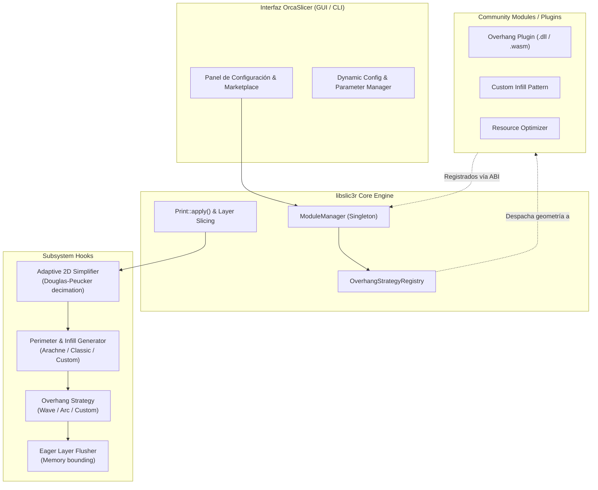
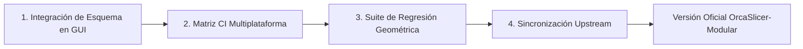
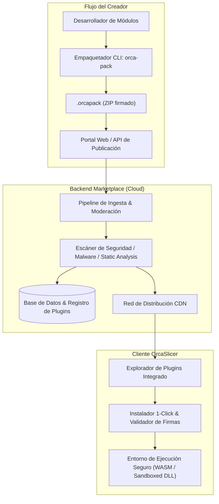

# Guía de Arquitectura Modular y Ecosistema de Plugins para OrcaSlicer

Este documento describe la arquitectura técnica interna de **OrcaSlicer-Modular**, el ciclo de vida de los módulos comunitarios, los puntos de enganche (*hooks*) en el motor geométrico de corte, y el diseño de software para la plataforma de distribución estilo Marketplace comunitario (análogo a MakerWorld).

---

## 1. Visión General de la Arquitectura

OrcaSlicer-Modular desacopla las estrategias de generación de trayectorias (overhangs, patrones de relleno, simplificación de mallas y optimización de recursos) del núcleo monolítico tradicional de Slic3r.



---

## 2. ABI y Ciclo de Vida del Módulo (`IOrcaMod`)

Todos los plugins implementan la interfaz base `IOrcaMod` definida en `libslic3r/Modular/ModuleABI.hpp`.

### 2.1 Puntos de Extensión (`SubsystemHook`)

| Hook | Descripción | Interfaz Requerida |
| :--- | :--- | :--- |
| `OverhangStrategy` | Controla generación de trayectorias en puentes y voladizos | `IOverhangStrategy` |
| `InfillPattern` | Introduce algoritmos personalizados de relleno o muros | `IWallInfillStrategy` |
| `ResourceOptimizer` | Modula hilos máximos y liberación anticipada de memoria intermedia | `IResourceOptimizer` |
| `KinematicsEngine` | Permite trayectorias no planares en 3 ejes o transformaciones cinemáticas | `IKinematicsMod` |
| `GCodePostProcessor` | Filtra o transforma el flujo emitido de G-code antes del volcado a disco | `IGCodeFilter` |
| `CustomUIWidget` | Añade parámetros y componentes interactivos en wxWidgets | `IUIWidgetDescriptor` |

### 2.2 Ciclo de Vida del Plugin

1. **Descubrimiento y Carga:** El `ModuleManager` lee los subdirectorios en `plugins/` buscando archivos de manifiesto `plugin.json` o librerías dinámicas (`.dll` / `.so`).
2. **Inicialización (`on_load`):** OrcaSlicer pasa un `ModuleContext` al plugin. En este paso el plugin registra sus interfaces y parámetros.
3. **Ejecución Durante el Corte:** Cuando el motor procesa capas o trayectorias, consulta al registro si hay un módulo activo asociado a la estrategia seleccionada. Si está activo, delega el cálculo; de lo contrario, ejecuta la ruta nativa base.
4. **Descarga (`on_unload`):** Se liberan buffers, memoria local y se desasocian los hooks.

---

## 3. Especificación del Manifiesto (`plugin.json`)

Cada módulo incluye un manifiesto declarativo que define su identidad, compatibilidad y parámetros configurables por el usuario:

```json
{
  "id": "com.community.custom_overhang",
  "name": "Custom Geometric Overhang Generator",
  "version": "1.0.0",
  "author": "Community Developer",
  "description": "Generador de trayectorias para voladizos extremos sin soportes.",
  "category": "OverhangStrategy",
  "entry_point": "libcustom_overhang.dll",
  "target_hook": "OverhangStrategy",
  "min_orcaslicer_version": "2.3.0",
  "active_by_default": true,
  "parameters": [
    {
      "key": "bridge_angle_threshold",
      "label": "Umbral de Ángulo (°)",
      "type": "float",
      "default": 45.0,
      "min": 10.0,
      "max": 85.0,
      "description": "Ángulos mayores usarán el generador geométrico del plugin."
    }
  ]
}
```

---

## 4. Plantillas de Código Disponibles

En `src/libslic3r/Modular/Templates/` se incluyen esqueletos listos para usar:

- **`TemplateOverhangPlugin.hpp`**: Para estrategias de voladizos (implementa `IOrcaMod` e `IOverhangStrategy`).
- **`TemplateInfillPlugin.hpp`**: Para nuevos rellenos y trayectorias de pared (implementa `IOrcaMod` e `IWallInfillStrategy`).
- **`TemplateResourceOptimizerPlugin.hpp`**: Para control adaptativo de hilos y memoria en modelos densos (implementa `IOrcaMod` e `IResourceOptimizer`).
- **`TemplateModExport.cpp`**: Muestra la exportación de símbolos en C (`create_orca_mod` y `destroy_orca_mod`) para compilaciones dinámicas compartidas.
- **`plugin.json.template`**: Esquema modelo para el manifiesto de distribución.

---

## 5. Hoja de Ruta: De Prueba de Concepto (PoC) a Versión Oficial

Para consolidar esta arquitectura en una versión oficial de OrcaSlicer lista para producción masiva, los siguientes componentes técnicos deben completarse:



1. **Integración Dinámica de Esquema en GUI (wxWidgets):**
   - Actualmente los parámetros se cargan en `ModuleManager`.
   - El subsistema `TabPrintModel` debe generar controles wxWidgets (sliders, checkboxes, combos) dinámicamente según el bloque `"parameters"` de cada `plugin.json`.
2. **Matriz de Integración Continua Multiplataforma (GitHub Actions):**
   - Pipelines automatizados para compilar dependencias y binarios en **Windows (MSVC)**, **Linux (GCC / Clang en Ubuntu)** y **macOS (Apple Clang universal arm64/x86_64)**.
3. **Suite de Pruebas de Regresión Geométrica (Golden Diffing):**
   - Generación automatizada de G-code con y sin módulos activos sobre un corpus de modelos de prueba (Benchys, esferas de voladizo, mallas STL/STEP complejas).
   - Verificación de que las trayectorias base no se degradan y que no existen fugas de memoria (`Valgrind` / `ASan`).
4. **Estrategia de Sincronización con Upstream:**
   - Mantener las extensiones modulares en directorios aislados (`libslic3r/Modular`) para que los merges futuros desde el repositorio oficial de OrcaSlicer no generen conflictos en el núcleo de rebanado.

---

## 6. Diseño del Marketplace Comunitario (Estilo MakerWorld)

Para permitir que cualquier usuario cree, publique, descargue y ejecute módulos comunitarios de forma segura y centralizada, se plantea la siguiente arquitectura:



### 6.1 Formato de Paquete Estándar: `.orcapack`
Un archivo `.orcapack` es un contenedor ZIP criptográficamente firmado que contiene:
- `manifest.json`: Metadatos, autor, versión mínima del slicer, dependencias y firmas.
- `icon.png`: Icono descriptivo (512x512).
- `README.md`: Documentación y ejemplos de uso en Markdown.
- `binary/`: Contiene el binario WebAssembly (`module.wasm`) o las librerías dinámicas precompiladas por plataforma (`windows_x64.dll`, `linux_x64.so`, `macos_arm64.dylib`).
- `signature.sig`: Firma criptográfica RSA/Ed25519 generada por la clave del autor y validada por el servidor del Marketplace.

### 6.2 Capa de Seguridad y Sandboxing (WebAssembly / WASI)
La ejecución de código de terceros en el ordenador del usuario conlleva riesgos de seguridad (código malicioso o bloqueos del slicer). La solución recomendada es la adopción gradual de **Wasmtime (WebAssembly Core)**:
- **Aislamiento Total de Memoria:** El plugin no tiene acceso a disco ni red fuera de los buffers geométricos proporcionados explícitamente por el rebanador.
- **Portabilidad Universal:** Un único archivo `.wasm` corre sin recompilar en Windows, Linux y macOS.

### 6.3 Infraestructura del Backend (Cloud)
- **API REST / GraphQL:** Para búsqueda, filtrado por categorías, recuento de descargas, calificaciones y comentarios.
- **Pipeline de Aprobación Automatizada:**
  - Análisis estático contra llamadas al sistema peligrosas.
  - Test de ejecución en contenedor headless para verificar que no provoque *crashes* ni bucles infinitos.
- **CDN Global:** Almacenamiento distribuido (Cloudflare R2 / AWS S3) para descargas de baja latencia.

### 6.4 Experiencia de Usuario dentro de OrcaSlicer
- **Pestaña "Marketplace" en la Interfaz Principal:** Vista con tarjetas visuales, capturas antes/después del rebanado, número de descargas y reseñas comunitarias.
- **Instalación en 1 Clic:** Descarga, verificación de integridad SHA-256 y activación en caliente sin necesidad de reiniciar la aplicación.
- **Control de Versiones y Actualizaciones:** Notificación automática cuando un creador publique una versión mejorada de un módulo instalado.
